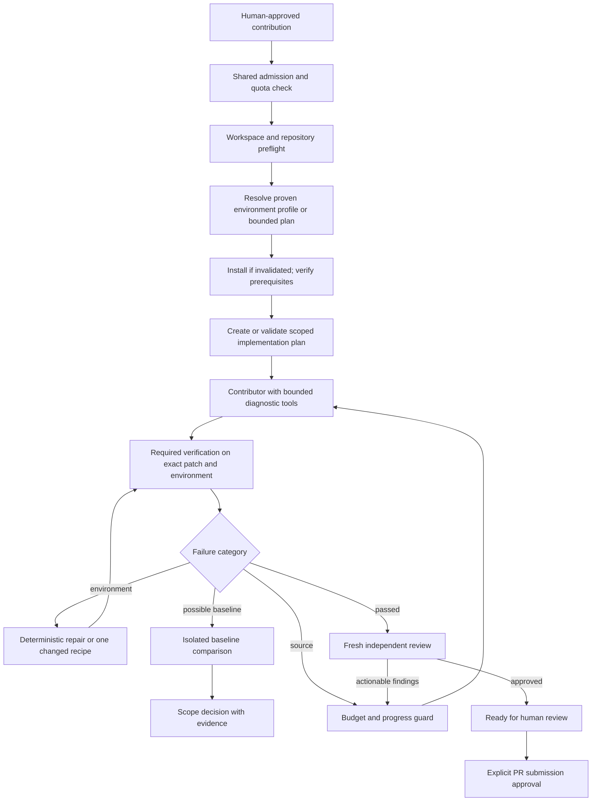

# Backend audit: Codex reliability, efficiency and next features

Audit date: 2026-10-12, Asia/Calcutta. Reviewed checkout: `5f855d79303b2c6f3491309a117173efad2ff0f0`, including the pipeline-7 environment work. This is an assessment and implementation roadmap; the proposed guards below have not been implemented by this audit.

ForgeFlow should first make every model call attributable, every retry justified, and every resumed phase correct. Its modular Go backend, isolated workspaces and existing approval gates are a suitable foundation. A framework migration, blanket model upgrade, or more autonomous agents is not necessary to make the next substantial improvement.

The highest-priority findings are incomplete usage accounting, unnecessary source fixing when review is interrupted, and missing shared limits on model activity. Verification selection and environment preparation also need stronger repository awareness. New product features should build on these corrections.

## Scope and evidence

Read `AGENTS.md`, the relevant requirements throughout `SPEC.md`, architecture/recovery/validation documents, and backend entry points and their callers. Traced contribution preparation through planning, provisioning, coding, verification, recovery, review and PR preparation/submission. Separately traced Arnyx chat and local workspace tasks, storage/usage aggregation, discovery/ranking, configuration and API lifecycle controls.

This is a backend architecture and execution-path audit, with targeted reproductions. It is not a claim of exhaustive security verification of every function or compatibility with every repository. The current paid Codex environment-planner workflow remains unverified end to end because the previous live attempt hit the account usage limit. This audit started no model sessions, resumed no existing contributions and performed no remote writes.

| Backend area | Assessment |
| --- | --- |
| `apps/server`, `project`, `config`, `domain` | Composition, startup recovery, selected runner/model, concurrency and configuration limits inspected. Keep the modular monolith. |
| `discovery`, `analyzer`, `ranking`, `estimator` | Discovery uses bounded GitHub requests; analysis/ranking/effort estimates are deterministic. No model call is needed here. Cost remains excluded from ranking. |
| `workspace`, `contributions` | Isolated clone/approval/model selection and preparation-to-execution handoff inspected. Keep explicit approvals and preserved partial work. |
| `codex` | CLI events, policy, usage extraction, model settings, command/container execution and environment setup inspected. Main gaps: per-call governance and same-environment diagnostic access. |
| `execution` | Phase resume, constraints, plans, tests, environment repair, transport retries, independent review and PR gates inspected. Several concrete flow defects/opportunities below. |
| `operator` | Chat and local-project task paths inspected separately. Their model use is absent from the contribution usage aggregate. |
| `storage` | Usage, execution/test/agent records, Arnyx history, transactions and immutable event behavior inspected. Preserve the audit trail while reducing future payload duplication. |
| `api`, `github`, `githubauth` | Request bounds, chat serialization, health, SSE, GitHub request budgets/cache/rate limiting and approval entry points inspected. No credential contents were read. |
| `testing` | Automatic command detection reproduced against disposable manifests. It is less general than the new container provisioning interface. |

Local audit artifacts are under `.cache/backend-audit/`. Reproduction programs use temporary repositories and an in-memory database. Flow probes are injected with Go's `-overlay`; they do not add test files to the production source tree. The live database was opened with SQLite `mode=ro` and `query_only=ON`, inside a read transaction. Only aggregate counters were exported.

## Measured usage: visibility is incomplete

Snapshot taken at `2026-10-11T22:05:23Z` (2026-10-12 local time). These are historical recorded counters, not a billing statement, an estimate of wasted tokens, or a pipeline-7 performance benchmark.

| Persisted source | Runs / events | Recorded input tokens | Recorded output tokens | Missing usage |
| --- | ---: | ---: | ---: | ---: |
| Contribution planner | 5 | 882,615 | 6,313 | 0 |
| Contribution contributor | 13 | 6,499,596 | 23,590 | 3 |
| Contribution reviewer | 2 | 425,766 | 2,074 | 1 |
| Arnyx workspace tasks | 3 | 916,974 | 5,470 | 0 |
| Successful Arnyx chat events | 6 | 130,918 | 958 | Failure-path coverage unknown |

The current `Usage()` query covers only `agent_runs`. It therefore omits **1,047,892 recorded input tokens and 6,428 recorded output tokens** from the two Arnyx sources in this snapshot. The omitted chat events can each include multiple model calls, so six events must not be presented as six model sessions.

Contribution records contain 7,807,977 input tokens, including 7,012,992 reported cached input tokens. Do not add cached input to input totals again or label all repeated context as waste. Reasoning/cache-write fields also need documented semantics before computing any combined metric. Four contribution runs have no usage; their consumption is unknown, not zero.

The largest observed inline prompt among 13 saved prompt events was 31,222 bytes. This does not measure repository reads, tool results, hidden instructions or total model context. It also means the potential 256 KiB prompt problem below was not demonstrated by this particular sample.

Evidence: `usage-snapshot.json`, generated by `inspect_usage.py`. The controlled accounting reproduction returned a successful Arnyx result with 1,234 input and 55 output tokens, persisted them in `ArnyxReplied`, then observed `Usage()` return zero sessions and an empty usage map. See `probe.log`.

## Findings and proposed guards

Priority meanings: **P1** should precede broader autonomous use; **P2** should follow in the next reliability/efficiency increment; **P3** is a measured optimization. Effort estimates below are relative engineering size, not delivery promises.

### F1 — P1: unify accounting and preserve partial/failed usage

**Verified:** [usage.go](../internal/storage/usage.go), lines 13–19, reads only `agent_runs`. Arnyx chat writes usage only at its successful final event in [ai.go](../internal/operator/ai.go), around lines 116–126 and 213. Workspace tasks store it in `arnyx_tasks` via [workspace.go](../internal/operator/workspace.go), around line 291. Chat errors after a successful lookup lose the accumulated usage from the final summary path. The CLI adapter fills `Result.Usage` only on `turn.completed` in [runner.go](../internal/codex/runner.go), around line 169.

**Guard:** add one model-call ledger shared by all three callers. Record call/attempt ID, purpose, contribution or conversation ID, session/turn IDs, requested and observed model where available, start/end, outcome, usage source, raw provider counters and completeness (`complete`, `partial`, `unavailable`). Persist completion in an independent audit context even when output validation or cancellation fails. Deduplicate cumulative observations instead of summing every usage event. Keep historical records unchanged; reconcile them into a new projection with explicit provenance.

**Acceptance:** a failed second lookup still accounts for the first call; cancellation reports unknown/partial usage honestly; replaying an event does not double count; the dashboard reconciles contribution, chat and workspace totals. Effort: medium.

### F2 — P1: interrupting review can spend an unnecessary coding iteration

**Reproduced:** [service.go](../internal/execution/service.go), around lines 380–402, changes `REVIEWING` to `FIXING` unconditionally on entry to the loop. A reviewer transport failure or pause can leave phase `REVIEWING` without a verdict. Resuming then starts a contributor and increments `FixIterations`, even though no reviewer requested changes.

The overlay fixture entered review with no verdict and observed `firstRole=contributor`, `FixIterations=1`. It stopped before model execution or edits. The first probe lacked the fixture's trusted Git snapshot and stopped at preflight; after adding the normal `prepareRuntime` setup, the reproduction passed. Both logs are retained.

**Guard:** distinguish review pending/interrupted from review completed with `REQUEST_CHANGES`. Resume the pending review against the same verified patch; invoke a contributor only for saved actionable findings. Bind verification/review to a patch and environment fingerprint; if either changed, reverify before review. Do not increment a source-fix counter for an interrupted review.

**Acceptance:** interrupt/restart at each phase boundary, including after model completion but before verdict persistence; resumed review with an unchanged patch launches zero contributor calls. Effort: small to medium.

### F3 — P1: limits exist, but there is no shared model spending policy

**Verified:** configuration exposes fix/review counts, not model-call or token budgets ([models.go](../internal/domain/models.go), `Config.Codex`). Contribution work has a two-hour deadline and each agent a 30-minute deadline; workspace tasks have 15 minutes and chat 150 seconds. The event stream is capped at 16 MiB. None is a total token limit. Recovery counts reset on an explicitly approved resume, so they are session limits rather than lifetime contribution limits.

Concurrency gates are separate: contribution tasks, two workspace tasks and one chat request. With default contributor concurrency two, these permit up to five top-level model processes across the three paths; reviewers occupy contribution tasks rather than adding another independent contribution worker. There is no account-wide quota circuit breaker shared by them.

**Guard:** put admission control around `Runner.Run`: a global concurrency ceiling, per-purpose call limits, per-contribution cumulative usage/call limits, daily optional limits, and reserved capacity for final verification/review. Persist consumed budget across restarts/resumes. A confirmed provider quota/auth failure should open a shared circuit until the reported reset or an explicit fresh check. A user-approved budget increase must be recorded as an increase, not erase prior consumption. Never feed these limits into opportunity ranking.

The existing `exec` usage is observed at completion, so a strict in-flight token ceiling cannot honestly be promised today. Initially enforce call/wall-time limits and observed-token admission limits, exposing possible overshoot. For tighter control, capability-test app-server usage events and interruption before adopting them. Current official documentation describes rate-limit reads, token notifications and turn interruption, but installed-version compatibility must be checked. [Codex App Server](https://learn.chatgpt.com/docs/app-server).

**Acceptance:** simultaneous contribution and Arnyx requests respect the same ceiling; a quota event prevents further launches; restarts cannot reset a cumulative budget; unavailable usage is visibly unknown. Effort: medium.

### F4 — P1: contribution constraints do not invalidate an approved plan

**Reproduced:** [controls.go](../internal/execution/controls.go), lines 14–37, changes only `Constraints`. The saved `Plan` and `PlanApproved` remain intact. The fixture changed acceptance criteria and still observed the old plan with `plan_approved=true`. `workflow()` plans only when `r.Plan == nil`.

This does not prove the model ignores the new constraint—it receives the text—but the orchestrator cannot demonstrate that the saved plan, test selection and approval match it.

**Guard:** bind plan/approval to issue, constraints, base and relevant instruction digests. A substantive constraint change marks the plan stale and requires a bounded plan update; preserve the old plan and patch. Invalidate readiness/review where applicable. Honor the existing optional human plan-approval setting after replanning.

**Acceptance:** changed constraints invalidate the old approval, repeated identical constraints do not, and a plan-only update cannot overwrite existing edits. Effort: small to medium.

### F5 — P1: verification discovery can impose the wrong test framework

**Reproduced:** [detect.go](../internal/testing/detect.go) maps any root `pyproject.toml` or `setup.py` to `python -m pytest`, invokes npm for Node scripts regardless of declared package manager, and checks only root manifests. A stdlib-only Python manifest produced pytest; a pnpm manifest produced npm commands; a nested Go module produced no commands. The Node mapping can work for some projects—it is a mismatch risk, not proof that every pnpm project fails.

[verificationCommands](../internal/execution/service.go), around line 535, unions detected commands with the plan and deduplicates only exact argv. The planner cannot replace a false-positive inferred pytest requirement with the repository's actual unittest command. A build script that already runs tests can also be followed by a duplicate full test run.

**Guard:** make detection produce candidates with manifest/CI evidence and confidence, not unconditional requirements. Resolve an explicit verification contract from CI and repository instructions; record why each required check exists. Support module working directories and declared package managers, with a generic command escape hatch inside the existing sandbox. Allow correction of a false inference with recorded evidence; never silently drop a genuine required check. Avoid arbitrary shell-equivalence guesses when deduplicating.

**Acceptance:** unittest-only Python, pnpm, nested Go, Rust, .NET and mixed-language fixtures select the correct working directories and commands. Every removed candidate has a recorded reason; the complete required suite remains mandatory. Effort: medium.

### F6 — P2: unchanged environments rerun installation; some setup failures unnecessarily call the model

**Reproduced:** the same ready recipe invoked `PrepareEnvironment` twice with one environment-planner call. The normal flow calls preparation before coding and again before testing ([service.go](../internal/execution/service.go), around lines 243 and 415). [PrepareEnvironment](../internal/codex/environment.go), around lines 399–405, repeats every workspace installation command and prerequisite check even on image reuse. An `npm ci` recipe can therefore repeat installation before the first real test.

Fresh readiness checks are valuable; skipping them blindly would regress reliability. The larger opportunity is to distinguish installation from validation. Additionally, [execution/environment.go](../internal/execution/environment.go), around lines 106–119, can request a new recipe for most failed preparation when downloads are approved. That decision does not first distinguish a fixable recipe from disk capacity, daemon outage or credential trouble.

**Guard:** retain fresh cheap checks, but use an installation stamp keyed by manifest/lock inputs, immutable image, workspace generation and recipe version. Verify expected artifacts before reuse; missing/corrupt artifacts invalidate the stamp. Classify provisioning failures before launching another planner. Disk/daemon/auth blockers should pause with deterministic remediation. Collapse identical concurrent image builds under a shared build lease; preserve cancellation ownership for each waiting contribution.

**Acceptance:** unchanged dependencies install once across coding/testing; deleting the venv or modules triggers repair; daemon outage makes zero recipe-planner calls; a failed installer never writes a ready stamp. Effort: medium. Savings are primarily wall time/I/O, with indirect model savings from avoiding misleading failures.

### F7 — P2: there is no shared no-progress guard for code and tools

**Verified:** fix/review iteration bounds and unchanged-environment fingerprints exist. There is no corresponding check that consecutive source-fix rounds actually change the patch or failure evidence. The heartbeat records activity; it does not identify repeated unsuccessful commands or stop a live agent that keeps doing the same work.

**Guard:** compute a normalized failure signature alongside patch, environment, required-command and constraint digests. If the same failure and same patch recur, stop before another source model call unless new evidence justifies it. Within a session, track repeated completed command fingerprints and unchanged results; distinguish useful long-running work from repeated attempts. Start with telemetry and conservative thresholds, then enable cancellation only after replay tests demonstrate it does not stop legitimate searches or flaky-test diagnosis. Preserve the failure history and explain the stop.

**Acceptance:** an unchanged patch and same assertion cannot consume all five default fixes; a genuinely different patch can continue; known transient errors retain their bounded backoff. Effort: medium.

### F8 — P2: a prompt byte cap is not a context-consumption guard

**Verified:** [prompt_evidence.go](../internal/execution/prompt_evidence.go) has useful per-command excerpts and a 64 KiB test-evidence budget. Its whole-prompt bound is 256 KiB, and overflow tells the agent to read the complete saved input. Reviewer prompts also inline the full diff. Environment evidence is repeatedly written to new filenames and agents are told to read setup logs. These protect transport size and preserve evidence, but can still lead to repeated model reads of large artifacts.

**Guard:** separate immutable evidence storage from the context supplied to each role. Send a compact manifest of changed files, relevant failures, prerequisite results and hashes; make artifacts addressable by record/file and bounded range. Keep full history available without asking every role to reread it. Log estimated prompt tokens separately from actual provider usage. Put stable role instructions before changing issue/evidence content and give prompt/schema versions stable identities.

Official caching guidance supports stable prefixes and measurement. It does not establish which API cache controls are exposed by the authenticated CLI, nor guarantee that a smaller or resumed prompt costs less. Benchmark total/cached input, output and success together. [Prompt caching](https://developers.openai.com/api/docs/guides/prompt-caching).

**Acceptance:** large history/diff fixtures stay within role budgets while critical findings remain accessible; repeated snapshots with identical content have one content-addressed artifact; no outcome is invented from an excerpt. Effort: medium.

### F9 — P2: every retry and follow-up starts a fresh Codex context

**Verified:** [Request](../internal/codex/runner.go), line 22, has no resume/thread field; `Run` always launches `exec`. Contribution transport retries therefore start over, albeit with instructions to preserve partial edits. Arnyx makes up to three fresh calls for one chat request as it appends lookup results. Workspace follow-ups send only clipped recent history.

**Guard:** first add durable stage-attempt identities and a small handoff containing completed work, last failed operation and next action. Then trial explicit-session continuation for the same contributor or same chat lookup chain, bound to the same workspace, role, approval and policy. Never use global `--last`, and never reuse a contributor context for independent review. Resume only after reconciling an ambiguous completion against saved output and workspace state. Use a fresh context or compaction when continuation is stale or more expensive.

The official CLI supports explicit session-ID resume; this is a capability to test, not evidence of automatic savings. [Non-interactive Codex](https://learn.chatgpt.com/docs/non-interactive-mode).

**Acceptance:** interrupted contributor work preserves edits and avoids full rediscovery; a mismatched workspace/session is refused; review still uses a separate context. Compare resume vs fresh on actual fixtures before making it the default. Effort: medium to large.

### F10 — P2: Codex lacks a direct, controlled diagnostic path into its prepared container

**Verified:** agents edit through the native CLI; Docker commands are invoked later by the orchestrator. The prompt explains the difference, and `ENVIRONMENT_BLOCKED` requests repair, but there is no agent tool to request a focused check in the selected container and receive its result during the same reasoning session. Model web search and MCP are also disabled in the contribution CLI policy.

**Guard:** add a narrow diagnostic broker: request an argv command in the active workspace using the selected image, existing network approval, timeout/output budget and remaining diagnostic allowance. Return a recorded result with the exact environment identity. Keep the Docker socket, host credentials and application writes inaccessible. Rate-limit repeated command requests. Introduce targeted official-document retrieval only when a versioned API question needs it, with caching and a lookup budget.

**Acceptance:** Codex can reproduce a container-only failure without guessing from its Windows shell; diagnostics cannot become a host command or substitute for mandatory verification. Effort: large. This is the useful interpretation of “give Codex access like the outer assistant”: equivalent evidence and scoped capabilities, not unrestricted host access.

### F11 — P2: baseline attribution relies mainly on model instructions

**Verified:** first implementation precedes repository verification; the fix prompt asks whether failures predate the patch, but there is no deterministic baseline comparison in the workflow. Known environment strings receive special handling; unknown failures can reach the code fixer.

**Guard:** when a credible failure may be unrelated, run a bounded relevant baseline check at the approved base in a separate disposable workspace with the same environment and command. Save base/patch outcomes together. Do this on demand; always running two entire suites would itself waste time. A baseline failure does not turn patched verification green or silently waive a requirement.

**Acceptance:** a pre-existing failing test produces a scope/baseline decision instead of unrelated source edits; a new regression still enters the fix path; the active patch remains untouched. Effort: medium.

### F12 — P2: generic provisioning still depends on model-discovered inputs

**Verified:** recipe fingerprints hash only `plan.Files`. No deterministic scanner establishes that all newly added/changed manifests, lockfiles, CI or runtime declarations are covered. Prerequisite checks are arbitrary commands; the validator cannot prove that `tool --version` actually enforces a version requirement. Cross-contribution recipe knowledge is not persisted as a validated repository profile. The configured base must also pass initial probes before a planner can choose another base.

**Guard:** maintain a deterministic bounded inventory of likely environment inputs, nested modules and CI files. Detect additions/deletions, compare declared input coverage, and require replan when relevant untracked requirements appear. Prefer an explicit repository recipe or previously proven profile before asking the model to infer one. Persist the actual resolved base digest with reuse policy; tags should refresh deliberately, not unexpectedly mid-contribution. Expose conflicting/ambiguous requirements as blockers. Keep generic commands for ecosystems the scanner does not understand.

**Acceptance:** adding a nested manifest invalidates readiness; source-only changes do not rebuild an image; a cached profile is reused only with matching inputs and fresh checks; configured-base failure gets a precise setup instruction. Effort: medium to large.

### F13 — P3: role-specific model and effort selection is absent

**Verified:** contribution stages all receive `c.CodexModel`; the request has no reasoning-effort field. Arnyx falls back to the CLI's configured model. This gives simple reproducibility, but no evaluated distinction between a small structured lookup and complex implementation/review.

**Proposal:** support explicit per-role presets after the accounting and eval foundations exist. Record selected model/effort and fallback reason; allow a bounded escalation only when evidence warrants it. Preserve user choice and independent review quality. Do not automatically pick a cheaper model based on unverified assumptions about task difficulty or entitlement.

**Acceptance:** a fixed corpus demonstrates quality and total usage for each preset; escalation cannot loop or violate the call budget. Effort: medium. No savings percentage is supportable yet.

### F14 — P3: evidence payloads are duplicated and synchronously persisted

**Verified:** agent events go to JSONL and SQLite; final results also go to agent records/events. `SaveExecution` emits the whole execution record, including potentially large diff/environment evidence, on updates. Test history is copied to fresh prompt snapshots. SSE emits event data to each listener; SQLite uses one pooled connection. The sampled database held 1,861 events with approximately 11.8 MB of JSON. That proves duplication scale, not a current latency bottleneck.

**Proposal:** preserve all historical events and their hashes. For future large payloads use immutable content-addressed artifacts plus compact event references, separate small live-progress projections, and paginated/range evidence reads. Measure event write latency and SSE bytes before adding queues or changing the database. A critical audit-write failure must still stop the action; do not trade correctness for throughput.

**Acceptance:** large logs stay inspectable after restart and export; old event cursors remain valid; compact UI events cannot conceal errors. Effort: medium.

## Recommended control flow

Every model stage writes the same call ledger. Every interruption resumes the actual unfinished stage. Unknown usage remains unknown. A limit produces a clear pause with preserved work; it never fabricates passing tests or silently removes required work.

## Next-feature roadmap

These extend the current product; basic health checks, editable PR drafts, approvals, independent review and restart recovery already exist and should not be rebuilt as “new” features.

| Order | Feature | User value and smallest useful version | Dependencies / effort | Completion evidence |
| --- | --- | --- | --- | --- |
| 1 | Execution budget and usage dashboard | Show contribution/chat/workspace usage together, unknown coverage, stage calls, cache counters and why work paused. Add an explicit budget-increase control. | F1–F3; medium | Totals reconcile to raw records; failed/cancelled calls are visible; no fabricated dollar or plan-allowance figures. |
| 2 | Reliable resume and incident explanation | “What failed, what changed, what will run next?” backed by saved evidence. Resume the unfinished stage; show stopped recovery attempts and exact remediation. | F2/F4/F7; medium | Review interruption starts no source edit; unchanged failure cannot silently repeat; new scope renews plan validity. |
| 3 | Repository readiness profile | Explain required languages, versions, dependencies, services, verification commands and cached image identity before coding. Reuse a proven profile for later contributions. | F5/F6/F12; medium–large | At least several distinct ecosystems plus one mixed repo pass real setup/test fixtures; invalidation and offline reuse demonstrated. |
| 4 | Regression and token-efficiency lab | Replay saved failures and compare runner/prompt/model changes on fixed disposable repositories. Show pass rate, calls, observed tokens, time and cleanup correctness. | Unified ledger; medium | One repeatable scorecard; model-free tests on ordinary CI, explicitly enabled live-model evals with a hard call budget. |
| 5 | Scoped container diagnostics | Let the contributor request a focused test in the actual prepared environment and receive the record immediately. | F10 and budgets; large | Real edit→diagnose→fix workflow; no host writes, leaked credentials or skipped full-suite checks. |
| 6 | Service dependency profiles | Start approved test databases/queues with per-contribution networks/volumes and health checks; no fixed shared ports. | Environment profiles and lifecycle ownership; large | Parallel contributions cannot reach each other's data; cancellation removes only owned resources; secrets are referenced, never baked into images. |
| 7 | PR follow-up inbox | Read-only CI, reviewer requests, closed/merged state and upstream links after `PR_OPENED`. Initially summarize deterministically; request a scoped fix only after approval. | Existing GitHub client; medium | Updates tied to the correct PR/head commit; stale or unavailable remote state is labelled; no automated comments/submissions/merges. |
| 8 | Repository-aware submission checklist | Read applicable PR templates and contributing requirements; expose draft/ready choice and missing attestations for the user. | Existing PR revision token; small–medium | Changing text or draft choice renews exact submission approval; no invented checklist answers. |
| 9 | Upstream drift and conflict preview | Show divergence from the approved base before expensive work or submission, then offer an isolated update rehearsal. | Patch/test identities; medium–large | Existing patch preserved; no force push; rebasing invalidates verification/review and needs explicit scope approval. |
| 10 | Evidence export and storage management | Export a redacted support bundle: version, recipe, command outcomes, incidents and usage. Show owned workspace/image/cache sizes and preview cleanup. | Artifact indexing; medium | Export has no credentials; audit history survives; cleanup excludes active work and never globally prunes Docker. |

GitHub exposes read APIs for [check runs](https://docs.github.com/en/rest/checks/runs) and [PR reviews](https://docs.github.com/en/rest/pulls/reviews), making the inbox a practical incremental feature. Fork synchronization can encounter conflicts, so update previews must retain an explicit conflict path rather than assume synchronization is harmless. [GitHub fork synchronization](https://docs.github.com/en/pull-requests/how-tos/work-with-forks/syncing-a-fork).

## Implementation sequence and evaluation gates

1. **Correctness increment:** fix review resumption and plan invalidation; add accounting coverage for all callers and failure paths. Acceptance uses the reproductions in this report as regression cases.
2. **Cost-control increment:** shared admission/budget/circuit-breaker service and no-progress detection. Keep conservative defaults; budget changes remain separate from ranking.
3. **Repository execution increment:** evidence-backed verification contract, install-vs-check separation and versioned readiness profiles. Expand real fixtures beyond Go/Node/Python before claiming general ecosystem support.
4. **Measured agent improvement:** trial explicit session continuation, compact role context, same-container diagnostics and role presets against the same evaluation corpus.
5. **Product expansion:** ship PR follow-up/checklist and evidence export; add service profiles only after cancellation/isolation tests cover multiple concurrent environments.

Track outcomes per task, not just tokens per request: correct-patch acceptance, required verification completion, independent-review validity, model calls, total/cached input and output, usage completeness, environment-vs-source recovery counts, repeated failure signatures, setup reuse, elapsed time, human interventions and orphan-resource count. Savings require a paired comparison at equal quality; shorter prompts or fewer tests alone are not success.

The eval corpus should include: clean small fix; nested/mixed-language repo; incompatible runtime; missing public package; private credential blocker; unavailable service; quota/auth failure before and during a stage; truncated logs; repeated unchanged code failure; baseline failure; interrupted reviewer; constraints changed after approval; corrupted cached dependencies; command that hangs with a child process; and restart after a model finishes but before its result is committed. Continuously extending a representative evaluation set follows official [evaluation guidance](https://developers.openai.com/api/docs/guides/evaluation-best-practices). Model graders may supplement, but cannot replace, actual commands and state/approval assertions.

## Skills and research decision

Used the installed OpenAI Docs and Find Skills guidance. Searched the skills directory and `npx skills find 'agent evaluation'`, then inspected primary repositories. Relevant candidates included [Trail of Bits audit-context-building](https://github.com/trailofbits/skills/blob/main/plugins/audit-context-building/skills/audit-context-building/SKILL.md) and [LangSmith skills](https://github.com/langchain-ai/langsmith-skills). The former is an extensive context-building workflow for unfamiliar code; the latter is tied to a tracing/evaluation ecosystem. Neither needed installation to validate these local Go orchestration defects. No third-party skill was installed or added to contribution-agent prompts.

Skills can help us conduct audits or write evals. They do not enforce budgets, fix phase transitions or make provider counters complete. Those protections belong in tested backend code. A future skill catalog should load only selected task-relevant instructions and record the version used; automatically loading many skills into each role could itself increase context cost.

## Validation record

- Disposable accounting and manifest-detection probes: passed; reproduced F1 and F5. `probe.log`.
- Overlay probes: reproduced unchanged preparation and retained plan approval. `flow-probes.log`. This log also retains the initial review-probe fixture setup failure, not a backend-test failure.
- Corrected interrupted-review probe: passed; reproduced F2 without executing a model or editing repository code. `review-resume-probe.log`.
- `go vet ./...`: passed. `go-vet.log`.
- `go test ./... -count=1`: all backend packages passed; execution tests took 208.102 seconds. `go-test.log`. Passing existing tests does not disprove the newly reproduced flow gaps, which are not covered by their current assertions.
- No live Codex calls, external contribution changes, PR operations or service restarts during this audit. Existing source work and concurrent user commits were preserved.

The most valuable first delivery is **correct resume + complete usage accounting + shared execution budgets**. It makes subsequent improvements measurable and prevents the new feature roadmap from multiplying the same failure modes.
